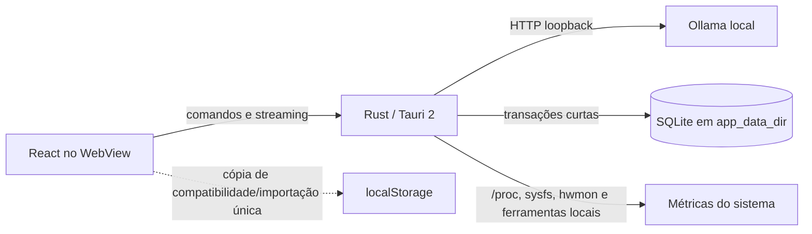

# AURION AI

Assistente desktop local em desenvolvimento, feito com Tauri 2, React, TypeScript e Rust. O projeto tem como plataforma alvo o Fedora Linux com KDE Plasma e Wayland, com conversas realizadas por meio de um servidor Ollama local.

> **Status:** aplicação local funcional em evolução. Chat com streaming, persistência SQLite e dashboard de métricas reais estão implementados. Voz, gestão de projetos e ferramentas de agente ainda não fazem parte do fluxo atual.

## Índice

- [Visão geral](#visão-geral)
- [Estado do projeto](#estado-do-projeto)
- [Arquitetura atual](#arquitetura-atual)
- [Requisitos](#requisitos)
- [Instalação no Fedora](#instalação-no-fedora)
- [Configuração do ambiente](#configuração-do-ambiente)
- [Configuração do Ollama](#configuração-do-ollama)
- [Conversa por voz no Fedora](#conversa-por-voz-no-fedora)
- [Execução e build](#execução-e-build)
- [Privacidade e segurança](#privacidade-e-segurança)
- [Estrutura do repositório](#estrutura-do-repositório)
- [Roadmap](#roadmap)
- [Referências oficiais](#referências-oficiais)

## Visão geral

O objetivo do AURION AI é oferecer um assistente pessoal que funcione localmente, converse em português brasileiro e, ao longo das próximas fases, ajude a acompanhar o computador e organizar projetos de desenvolvimento.

| Área | Tecnologia ou alvo |
| --- | --- |
| Aplicação desktop | Tauri 2 |
| Interface | React 19, TypeScript e Vite |
| Backend nativo | Rust |
| Banco local | SQLite com migration versionada e importação do histórico legado |
| Modelo padrão | Ollama com Qwen 3.5 4B (editável na aba **IA**) |
| Sistema alvo | Fedora 44, KDE Plasma e Wayland |
| Hardware de referência | Intel Core i5-12450H, NVIDIA RTX 2050 4 GB e 16 GB de RAM |

O uso do Ollama e a execução local do modelo não exigem uma conta ou uma API comercial. É necessária uma conexão com a internet para instalar as dependências e baixar o modelo pela primeira vez. Depois do download, o Ollama pode executar o modelo localmente.

## Estado do projeto

| Recurso | Estado atual |
| --- | --- |
| Interface desktop de três áreas | Implementada; janela configurada para 1440×900, mínimo 1000×680 |
| Chat textual com Ollama | Streaming pelo backend Rust; falhas são repetíveis, cancelamento descarta a resposta tardia e respostas parciais ficam marcadas como incompletas |
| Verificação da API local do Ollama | Estado do serviço separado do estado do modelo |
| Histórico de conversas | SQLite no diretório de dados Tauri; importa uma vez a chave legada `jarvis.conversations` e mantém a cópia de compatibilidade |
| Configuração do endpoint e modelo | Endereço configurável por Vite em loopback; modelo e permanência ajustáveis na aba **IA** |
| Monitoramento de CPU, GPU, RAM e temperaturas | Coleta local independente por campo; sensores indisponíveis aparecem como N/D |
| Renderização de respostas | Markdown sem HTML bruto nem imagens remotas automáticas; links são filtrados |
| Cadastro, pesquisa e permissões de projetos | Gestão de projetos ainda não implementada; a busca atual pesquisa títulos de conversas |
| Conversa por voz | Microfone, transcrição local e leitura de respostas. Requer PipeWire, whisper.cpp e Piper instalados |
| Empacotamento e validação do RPM | Ainda não validados |

O SQLite é a fonte persistente principal depois da inicialização. Conversas antigas em `localStorage` são importadas em uma transação e a chave original não é removida. Os dados do dashboard são leituras da máquina atual, não um inventário fixo de hardware.

## Arquitetura atual



O React usa comandos Tauri assíncronos para consultar modelos e enviar chat. O stream NDJSON é analisado incrementalmente em Rust e encaminhado ao React por canal Tauri. As conversas são persistidas no arquivo `jarvis.db` dentro do diretório de dados do aplicativo. O dashboard chama uma coleta nativa a cada dois segundos enquanto a aba Sistema está ativa.

## Requisitos

- Fedora Linux com ambiente gráfico; KDE Plasma e Wayland são a plataforma alvo do produto.
- Node.js compatível com a versão instalada do Vite. Para Vite 8, use Node.js `20.19+` ou `22.12+`.
- npm.
- Rust stable e Cargo, instalados pelo `rustup`.
- Dependências de desenvolvimento Linux do Tauri e WebKitGTK 4.1.
- Ollama instalado e acessível localmente para usar o chat.

## Instalação no Fedora

### 1. Instale as dependências nativas do Tauri

Os pacotes abaixo seguem a lista de dependências Linux/Fedora da documentação do Tauri:

```bash
sudo dnf check-update
sudo dnf install webkit2gtk4.1-devel openssl-devel curl wget file \
  libappindicator-gtk3-devel librsvg2-devel libxdo-devel
sudo dnf group install "c-development"
```

### 2. Instale Node.js e Rust

Instale uma versão compatível do Node.js e o Rust stable. Consulte as instruções oficiais em [Node.js](https://nodejs.org/en/download) e [Rust](https://www.rust-lang.org/tools/install). Confirme que os comandos estão disponíveis:

```bash
node --version
npm --version
rustc --version
cargo --version
```

### 3. Prepare o projeto

Na pasta do repositório:

```bash
npm ci
cp .env.example .env.local
```

Edite `.env.local` se precisar usar outro endereço ou modelo. Esse arquivo é local e está ignorado pelo Git.

## Configuração do ambiente

O arquivo versionado [`.env.example`](.env.example) contém os valores padrão:

```dotenv
VITE_OLLAMA_BASE_URL=http://127.0.0.1:11434
VITE_OLLAMA_MODEL=qwen3.5:4b
```

| Variável | Descrição | Padrão |
| --- | --- | --- |
| `VITE_OLLAMA_BASE_URL` | Endereço base do Ollama. Não inclua `/api` no final. | `http://127.0.0.1:11434` |
| `VITE_OLLAMA_MODEL` | Nome do modelo local usado inicialmente pelo chat. | `qwen3.5:4b` |

O Vite carrega `.env.local` durante desenvolvimento e build. Variáveis com prefixo `VITE_` são incluídas no frontend e **não são apropriadas para segredos, senhas ou chaves privadas**. O projeto não precisa de uma chave de API para o Ollama local.

## Configuração do Ollama

Instale o Ollama pelas [instruções oficiais para Linux](https://docs.ollama.com/linux). Baixe o modelo configurado no exemplo:

```bash
ollama pull qwen3.5:4b
ollama list
```

O serviço do Ollama normalmente atende em `127.0.0.1:11434`. Se ele não estiver ativo como serviço, inicie-o em um terminal:

```bash
ollama serve
```

Confira a API local:

```bash
curl http://127.0.0.1:11434/api/tags
```

### Comunicação local com o Ollama

O React chama comandos assíncronos Tauri; o backend Rust faz as requisições para o endereço configurado, que deve ser HTTP em loopback (`localhost` ou `127.0.0.1`). Assim, o WebView não acessa a API do Ollama diretamente e não precisa de configuração CORS. O backend rejeita endereços remotos. Mantenha o Ollama vinculado a loopback; não exponha a API em `0.0.0.0`.

## Pesquisa na web

O Aurion busca fontes automaticamente para perguntas sobre fatos externos, lançamentos, notícias e versões públicas. Pergunte **“Como está o lançamento do GTA VI?”** para testar. Perguntas sobre o próprio computador, traduções e textos a editar seguem pelo fluxo local. **“Pesquise sobre…”** também aciona a busca. Quando a resposta anterior teve fontes, uma continuação curta como **“E no PC?”** pode reaproveitar o assunto da pesquisa.

O serviço online recebe a consulta e devolve até três fontes. O Aurion gera a resposta na máquina e mostra os links abaixo dela. A interface indica antes do envio quando a consulta vai para o Ollama. A pesquisa precisa de conexão e de um serviço configurado. Quando a busca falha, o Aurion informa o erro e permite tentar novamente.

### SearXNG local sem chave do Ollama

O Aurion usa o SearXNG quando `AURION_SEARXNG_URL` aponta para uma instância no seu computador. O SearXNG recebe a consulta e a encaminha aos buscadores habilitados. A geração da resposta segue no Ollama local.

No Fedora, instale o Podman se precisar, com `sudo dnf install podman`. Configure a instância e inicie o contêiner:

```bash
searx_dir="${XDG_CONFIG_HOME:-$HOME/.config}/aurion/searxng"
mkdir -p "$searx_dir"
if [ ! -f "$searx_dir/settings.yml" ]; then
  searx_secret="$(python3 -c 'import secrets; print(secrets.token_hex(32))')"
  cat > "$searx_dir/settings.yml" <<EOF_SETTINGS
use_default_settings: true
server:
  secret_key: "$searx_secret"
  limiter: false
search:
  formats:
    - html
    - json
EOF_SETTINGS
fi

podman run -d --name aurion-searxng -p 127.0.0.1:8888:8080 \
  -v "$searx_dir:/etc/searxng:Z" docker.io/searxng/searxng:latest
```

Depois que o serviço iniciar, teste a busca e abra o Aurion:

```bash
curl -fsS -G 'http://127.0.0.1:8888/search' \
  --data-urlencode 'q=Fedora Linux' --data 'format=json'

AURION_SEARXNG_URL=http://127.0.0.1:8888 npm run tauri dev
```

Se o contêiner já existir e estiver parado, use `podman start aurion-searxng`. Se o JSON vier com poucos ou nenhum resultado, teste outra consulta e confira os motores da instância pelo endereço local.

### Serviço de busca do Ollama

Crie uma chave em [Ollama](https://ollama.com/settings/keys) e execute o comando abaixo na pasta do projeto. Cole a chave quando o terminal pedir e pressione Enter. A digitação fica oculta. O aplicativo lê a chave pelo ambiente do backend.

```bash
(
  read -rsp 'Chave do Ollama: ' OLLAMA_API_KEY &&
  printf '\n' &&
  export OLLAMA_API_KEY &&
  npm run tauri dev
)
```

Para conferir a chave sem imprimi-la, execute:

```bash
(
  read -rsp 'Chave do Ollama: ' OLLAMA_API_KEY || exit
  printf '\n'
  printf 'Authorization: Bearer %s\n' "$OLLAMA_API_KEY" |
    curl -sS --max-time 15 -o /dev/null -w 'HTTP %{http_code}\n' \
      --header @- --json '{"query":"Fedora Linux","max_results":1}' \
      https://ollama.com/api/web_search
)
```

Um HTTP 200 confirma o acesso. Para HTTP 401, confira a chave criada em ollama.com e inicie o Aurion com ela. Para HTTP 403, verifique o acesso à busca no painel da sua conta Ollama. Se o serviço retornar HTTP 402, verifique faturamento ou use o SearXNG local.

## Conversa por voz no Fedora

Instale as ferramentas abaixo na sessão de usuário que roda o Aurion. A voz usa a entrada e a saída padrão configuradas no Fedora. Depois da instalação e dos downloads, gravação, transcrição e síntese funcionam localmente.

```bash
sudo dnf install pipewire-utils wireplumber git cmake gcc-c++ make curl python3 python3-pip

voice_dir="${XDG_DATA_HOME:-$HOME/.local/share}/br.com.jarvis.ai/voice"
mkdir -p "$voice_dir"
whisper_src="$(mktemp -d)/whisper.cpp"
git clone --depth 1 --branch v1.9.6 https://github.com/ggml-org/whisper.cpp.git "$whisper_src"
cmake -S "$whisper_src" -B "$whisper_src/build" \
  -DCMAKE_BUILD_TYPE=Release -DBUILD_SHARED_LIBS=OFF \
  -DCMAKE_INSTALL_PREFIX="$voice_dir/whisper"
cmake --build "$whisper_src/build" --config Release --parallel
cmake --install "$whisper_src/build"
curl -fL --retry 2 -o "$voice_dir/ggml-base.bin" \
  https://huggingface.co/ggerganov/whisper.cpp/resolve/main/ggml-base.bin

python3 -m venv "$voice_dir/venv"
"$voice_dir/venv/bin/python" -m pip install 'piper-tts==1.8.0'
piper_source="https://huggingface.co/rhasspy/piper-voices/resolve/2f358b6a560e3a913ebf509b2f3344f20b367f94/pt/pt_BR/faber/medium"
for file in pt_BR-faber-medium.onnx pt_BR-faber-medium.onnx.json MODEL_CARD; do
  curl -fL --retry 2 -o "$voice_dir/$file" "$piper_source/$file"
done
```

O Aurion procura o Whisper e o Piper nos caminhos instalados acima e aceita os executáveis `whisper-cli` e `piper` no PATH como alternativa. Para usar outra pasta com os modelos e executáveis locais, defina `AURION_VOICE_DIR` no ambiente do processo Tauri. O arquivo `ggml-base.bin` deve ser a versão multilíngue. O Whisper recebe `-l pt` e transcreve sem traduzir. A voz Faber é `pt_BR`.

Se o modelo base trocar ou omitir palavras durante o ditado, experimente o Whisper small multilíngue. Ele ocupa mais espaço e pode levar mais tempo para transcrever. O Aurion usa `ggml-small.bin` quando o arquivo está na pasta de voz e usa `ggml-base.bin` quando o small está ausente.

```bash
voice_dir="${XDG_DATA_HOME:-$HOME/.local/share}/br.com.jarvis.ai/voice"
curl -fL --retry 2 -o "$voice_dir/ggml-small.bin.part" \
  https://huggingface.co/ggerganov/whisper.cpp/resolve/main/ggml-small.bin &&
mv "$voice_dir/ggml-small.bin.part" "$voice_dir/ggml-small.bin"
```

### Fontes e licenças

- O [whisper.cpp](https://github.com/ggml-org/whisper.cpp/blob/v1.9.6/LICENSE) e os [pesos Whisper em formato GGML](https://huggingface.co/ggerganov/whisper.cpp) usam MIT.
- O [motor Piper](https://github.com/OHF-Voice/piper1-gpl/blob/main/COPYING) usa GPLv3 e roda como executável separado. A revisão indicada do [modelo Faber](https://huggingface.co/rhasspy/piper-voices/commit/2f358b6a560e3a913ebf509b2f3344f20b367f94) foi treinada com um conjunto CC0 e parte da base Hi-Fi TTS de Cori Samuel (leitora 92), sob CC BY 4.0. Preserve essa atribuição conforme o [guia de licenças das vozes do Piper](https://github.com/OHF-Voice/piper1-gpl/blob/main/docs/LICENSING.md). Os pesos são baixados separadamente do aplicativo.

### Teste no Aurion

1. Confira os dispositivos padrão no painel de som do Fedora ou com `wpctl status`. Abra o aplicativo com `npm run tauri dev` e confirme que o modelo Ollama aparece como pronto na aba **IA**.
2. Clique no microfone, espere aparecer **Gravando · pode falar**, fale em português e clique novamente para transcrever. A gravação também termina ao atingir 60 segundos. Revise a transcrição no campo de mensagem e clique em enviar. Se já havia texto no campo, a transcrição é acrescentada.
3. Aguarde a primeira frase da resposta. Em um envio por ditado, o Aurion sintetiza trechos em ordem enquanto o Ollama ainda pode estar gerando. O texto completo aparece normalmente. Use o botão de voz para interromper a leitura sem cancelar o chat. **Ouvir resposta** também permite reproduzir uma resposta escrita ou já salva.
4. Confira que é possível continuar digitando e enviando mensagens quando as ferramentas de voz estão ausentes.

Os arquivos temporários de áudio e de texto são removidos ao terminar a operação. Só o conteúdo enviado entra no histórico de conversas.

Na leitura, o Aurion usa o texto dos títulos, listas e links, omite emojis e anuncia a presença de blocos de código. O Markdown original continua disponível na conversa, na cópia e na exportação.

O controle **Volume da voz do Aurion** é salvo neste dispositivo e vale a partir da próxima reprodução ou do próximo trecho. Em 100%, o Aurion reproduz o sinal original. Ele não amplifica o sinal nem altera a saída padrão do Fedora. Se o volume estiver baixo em 100%, confira o fluxo **Aurion** e o dispositivo de saída no painel de som enquanto a voz está tocando.

### Chamar o J por “Jota” no Fedora

A escuta por nome começa pausada. Instale o Whisper como descrito acima e adicione o detector no mesmo diretório de voz. Os comandos abaixo usam Python, curl e unzip e podem ser executados com a conta do usuário.

```bash
voice_dir="${AURION_VOICE_DIR:-${XDG_DATA_HOME:-$HOME/.local/share}/br.com.jarvis.ai/voice}"
wake_dir="$voice_dir/wake"
mkdir -p "$wake_dir"
python3 -m venv "$wake_dir/venv"
"$wake_dir/venv/bin/python" -m pip install 'vosk==0.3.45'
curl -fL --retry 2 -o "$wake_dir/vosk-model-small-pt-0.3.zip" \
  https://alphacephei.com/vosk/models/vosk-model-small-pt-0.3.zip
unzip -n "$wake_dir/vosk-model-small-pt-0.3.zip" -d "$wake_dir"
```

No chat, selecione **Ativar escuta por Jota**. Quando o indicador mostrar **Aguardando “Jota”**, diga “Oi, Jota, como está meu computador?” de uma vez. Se disser só “Jota”, aguarde o aviso **Estou ouvindo. Pode falar.** e faça o pedido. Revise o texto antes de enviar. O envio usa as mesmas ferramentas do chat e lê a resposta com a voz selecionada. O microfone manual e a reprodução da voz suspendem temporariamente a escuta pelo nome.

Em **Dashboard → IA → Escuta por Jota**, é possível manter o J na bandeja ao fechar a janela ou iniciar o J na bandeja após o login. O login preserva a escolha entre escutar e ficar pausado. Use o menu da bandeja para abrir o J, pausar ou retomar a escuta, ou encerrar o processo. Para o login, prefira o aplicativo instalado em um caminho permanente. A sessão do KDE controla se a janela que reapareceu também recebe foco.

O [Vosk](https://github.com/alphacep/vosk-api/blob/master/COPYING) e o [modelo português de 31 MB](https://alphacephei.com/vosk/models) usam Apache 2.0 e funcionam offline depois de instalados. O J verifica se “jota” está no vocabulário e configura uma gramática curta com saudações, alternativas e sons desconhecidos. A detecção usa o áudio e mantém até 3,2 segundos em memória para preservar o começo da frase. O Whisper transcreve em português depois do chamado e do fim da fala. Somente o áudio da fala ativada usa um WAV temporário, removido após a transcrição ou o cancelamento. A captura de fundo não depende do Ollama nem usa VRAM.

Ruído, sotaques e conversas que começam com um nome parecido podem afetar a detecção. Se o PipeWire perder áudio, o indicador mostra o erro e a escuta tenta reconectar ao microfone padrão. O modelo não identifica quem falou.

Para rodar os testes da captura simulada e das pronúncias sintéticas, instale também eSpeak NG e FFmpeg e execute na raiz do projeto:

```bash
JOTA_TEST_MODEL="$wake_dir/vosk-model-small-pt-0.3" PYTHONDONTWRITEBYTECODE=1 \
  "$wake_dir/venv/bin/python" -m unittest discover -s tests -p test_wake_worker.py -v
```

### Testar a entrada de áudio

Se a transcrição chegar com palavras trocadas ou faltando, grave a mesma frase fora do Aurion e ouça a entrada padrão do Fedora. O teste grava oito segundos. Conte um segundo antes de falar e deixe uma pausa depois da última palavra.

```bash
audio_test_dir="$(mktemp -d)"
pw-record --rate=16000 --channels=1 --format=s16 --sample-count=128000 "$audio_test_dir/ditado.wav" &&
pw-play "$audio_test_dir/ditado.wav"
```

Se a gravação já sair cortada, abafada ou distorcida, confira a fonte padrão e o nível de entrada em Configurações do Sistema → Áudio. Se a gravação estiver clara, compare a transcrição da mesma amostra usando os modelos instalados:

```bash
voice_dir="${AURION_VOICE_DIR:-${XDG_DATA_HOME:-$HOME/.local/share}/br.com.jarvis.ai/voice}"
for modelo in ggml-base.bin ggml-small.bin; do
  [ -s "$voice_dir/$modelo" ] || continue
  printf '\n%s\n' "$modelo"
  "$voice_dir/whisper/bin/whisper-cli" --no-gpu -l pt -nt \
    -m "$voice_dir/$modelo" -f "$audio_test_dir/ditado.wav"
done
```

O teste usa a amostra local. Os modelos comparam a mesma entrada, independente do Ollama.

## Execução e build

| Comando | Finalidade |
| --- | --- |
| `npm run tauri dev` | Inicia a aplicação desktop em modo de desenvolvimento. |
| `npm run dev` | Inicia somente o servidor de desenvolvimento web do Vite. |
| `npm run build` | Verifica os tipos TypeScript e gera os arquivos web de produção. |
| `npm run tauri build` | Gera o pacote desktop com Tauri para a plataforma local. |

O suporte a RPM aparece como meta na especificação do produto, mas a configuração e o resultado do empacotamento ainda precisam ser validados no Fedora.

## Privacidade e segurança

- As mensagens são enviadas pelo backend Rust ao Ollama local. O histórico principal fica em SQLite no diretório de dados do aplicativo Tauri (`jarvis.db`); a chave `jarvis.conversations` do WebView é mantida como cópia de compatibilidade e fonte da importação legada.
- O padrão aponta para loopback (`127.0.0.1`); não configure um servidor remoto se quiser manter o processamento nesta máquina.
- O download inicial do Ollama e do modelo requer internet. Este protótipo não chama uma API comercial.
- O app não captura áudio atualmente. Não há gravação de áudio ou transcrição implementada.
- `.env.local` pode conter configurações locais; nunca adicione arquivos `.env` ao Git. O `.env.example` deve conter somente valores públicos e genéricos.
- Permissões por projeto, confirmação de ações do agente e ativação pela frase “Ei, Aurion” ainda não foram implementadas. A coleta de temperatura e estatísticas da GPU depende do driver e dos sensores disponíveis; velocidade da RAM pode não estar acessível sem uma fonte EDAC/SMBIOS legível.

## Estrutura do repositório

```text
.
├── public/                 # Recursos estáticos da interface
├── src/                    # Interface React e configuração de tipos Vite
├── src-tauri/              # Aplicação nativa, configuração, capacidades e ícones
├── .env.example            # Modelo versionado de configuração local
├── package.json            # Scripts e dependências JavaScript
└── README.md               # Documentação do projeto
```

## Roadmap

O plano de trabalho segue a especificação funcional do AURION AI:

1. **Fundação:** chat local, streaming, configuração, histórico SQLite e métricas de hardware implementados; estabilização e empacotamento RPM pendentes.
2. **Projetos:** cadastro e gestão de workspaces, busca de conteúdo e associação ao histórico.
3. **Voz:** detecção de palavra de ativação, VAD, transcrição e síntese locais.
4. **Contexto e memória:** indexação autorizada de arquivos e memória controlável.
5. **Agente:** ferramentas locais supervisionadas e registro das operações.

## Referências oficiais

As referências abaixo documentam as ferramentas, os requisitos e a sintaxe usada neste repositório. A estrutura em seções e links segue práticas de documentação para repositórios e Markdown descritas pela Microsoft e pelo GitHub.

- **Microsoft Learn:** [README e Wiki de projetos no Azure DevOps](https://learn.microsoft.com/en-us/azure/devops/project/wiki/about-readme-wiki) — documentação de README e wiki para projetos.
- **GitHub Docs (Microsoft):** [Formatação básica de Markdown](https://docs.github.com/en/get-started/writing-on-github/getting-started-with-writing-and-formatting-on-github/basic-writing-and-formatting-syntax) — títulos, links, listas e blocos de código.
- **Tauri:** [Pré-requisitos para Linux e Fedora](https://v2.tauri.app/start/prerequisites/) e [configuração](https://v2.tauri.app/reference/config/).
- **Ollama:** [API de chat](https://docs.ollama.com/api/chat), [FAQ e configuração local](https://docs.ollama.com/faq) e [biblioteca Qwen 3.5 4B](https://ollama.com/library/qwen3.5:4b).
- **Rust:** [Instalação oficial](https://doc.rust-lang.org/book/ch01-01-installation.html).
- **React:** [Documentação oficial](https://react.dev/learn).
- **Vite:** [Guia de início e requisitos do Node.js](https://vite.dev/guide/).
- **Tauri SQL Plugin:** [Documentação do plugin e migrations](https://docs.rs/tauri-plugin-sql/latest/tauri_plugin_sql/).
- **SQLite:** [Documentação oficial](https://www.sqlite.org/docs.html).
- **Fedora:** [Documentação oficial do Fedora](https://docs.fedoraproject.org/).
