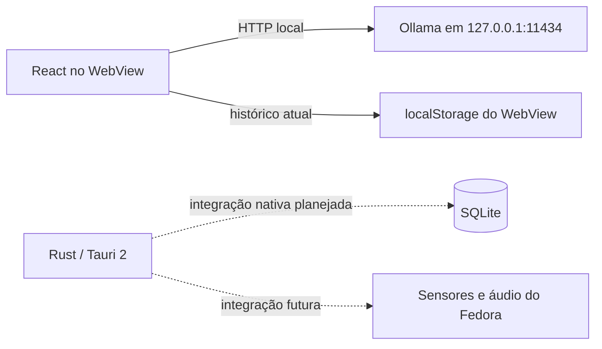

# JARVIS AI

Assistente desktop local em desenvolvimento, feito com Tauri 2, React, TypeScript e Rust. O projeto tem como plataforma alvo o Fedora Linux com KDE Plasma e Wayland, com conversas realizadas por meio de um servidor Ollama local.

> **Status:** protótipo inicial. Este repositório ainda não implementa toda a especificação funcional do JARVIS AI. Consulte [Estado do projeto](#estado-do-projeto) antes de contar com recursos de voz, projetos, SQLite ou monitoramento de hardware.

## Índice

- [Visão geral](#visão-geral)
- [Estado do projeto](#estado-do-projeto)
- [Arquitetura atual](#arquitetura-atual)
- [Requisitos](#requisitos)
- [Instalação no Fedora](#instalação-no-fedora)
- [Configuração do ambiente](#configuração-do-ambiente)
- [Configuração do Ollama](#configuração-do-ollama)
- [Execução e build](#execução-e-build)
- [Privacidade e segurança](#privacidade-e-segurança)
- [Estrutura do repositório](#estrutura-do-repositório)
- [Roadmap](#roadmap)
- [Referências oficiais](#referências-oficiais)

## Visão geral

O objetivo do JARVIS AI é oferecer um assistente pessoal que funcione localmente, converse em português brasileiro e, ao longo das próximas fases, ajude a acompanhar o computador e organizar projetos de desenvolvimento.

| Área | Tecnologia ou alvo |
| --- | --- |
| Aplicação desktop | Tauri 2 |
| Interface | React 19, TypeScript e Vite |
| Backend nativo | Rust |
| Banco planejado | SQLite com migrations versionadas |
| Modelo planejado | Ollama com Qwen 3.5 4B |
| Sistema alvo | Fedora 44, KDE Plasma e Wayland |
| Hardware de referência | Intel Core i5-12450H, NVIDIA RTX 2050 4 GB e 16 GB de RAM |

O uso do Ollama e a execução local do modelo não exigem uma conta ou uma API comercial. É necessária uma conexão com a internet para instalar as dependências e baixar o modelo pela primeira vez. Depois do download, o Ollama pode executar o modelo localmente.

## Estado do projeto

| Recurso | Estado atual |
| --- | --- |
| Interface desktop de três áreas | Implementada como interface inicial |
| Chat textual com Ollama | Implementado com resposta não transmitida em streaming |
| Verificação da API local do Ollama | Implementada |
| Histórico de conversas | Persistido no `localStorage` do WebView |
| Configuração do endpoint e modelo | Disponível por variáveis Vite e editável na aba **IA** |
| Monitoramento de CPU, GPU, RAM e temperaturas | Não implementado; os valores reais são mostrados como indisponíveis |
| Cadastro, pesquisa e permissões de projetos | Não implementado |
| Persistência SQLite e migrations | Dependência presente; ainda não conectada ao fluxo da aplicação |
| Wake word, captura, STT e TTS | Não implementados; o botão de microfone está indisponível |
| Empacotamento e validação do RPM | Ainda não validados |

Os indicadores visuais do painel não representam leituras reais. O estado de chat e as conversas guardadas no `localStorage` não são compartilhados com SQLite e podem não ser preservados se os dados do WebView forem removidos.

## Arquitetura atual



Atualmente, o chat no frontend chama os endpoints `/api/tags` e `/api/chat` do Ollama. O endpoint e o modelo padrão são fornecidos pelas variáveis de ambiente documentadas abaixo. O plugin SQL está listado no projeto Tauri, mas o aplicativo ainda não cria tabelas nem lê ou grava conversas em SQLite.

## Requisitos

- Fedora Linux com ambiente gráfico; KDE Plasma e Wayland são a plataforma alvo do produto.
- Node.js compatível com a versão instalada do Vite. Para Vite 8, use Node.js `20.19+` ou `22.12+`.
- npm.
- Rust stable e Cargo, instalados pelo `rustup`.
- Dependências de desenvolvimento Linux do Tauri e WebKitGTK 4.1.
- Ollama instalado e acessível localmente para usar o chat.

## Instalação no Fedora

### 1. Instale as dependências nativas do Tauri

Os pacotes abaixo seguem a lista de dependências Linux/Fedora da documentação do Tauri:

```bash
sudo dnf check-update
sudo dnf install webkit2gtk4.1-devel openssl-devel curl wget file \
  libappindicator-gtk3-devel librsvg2-devel libxdo-devel
sudo dnf group install "c-development"
```

### 2. Instale Node.js e Rust

Instale uma versão compatível do Node.js e o Rust stable. Consulte as instruções oficiais em [Node.js](https://nodejs.org/en/download) e [Rust](https://www.rust-lang.org/tools/install). Confirme que os comandos estão disponíveis:

```bash
node --version
npm --version
rustc --version
cargo --version
```

### 3. Prepare o projeto

Na pasta do repositório:

```bash
npm ci
cp .env.example .env.local
```

Edite `.env.local` se precisar usar outro endereço ou modelo. Esse arquivo é local e está ignorado pelo Git.

## Configuração do ambiente

O arquivo versionado [`.env.example`](.env.example) contém os valores padrão:

```dotenv
VITE_OLLAMA_BASE_URL=http://127.0.0.1:11434
VITE_OLLAMA_MODEL=qwen3.5:4b
```

| Variável | Descrição | Padrão |
| --- | --- | --- |
| `VITE_OLLAMA_BASE_URL` | Endereço base do Ollama. Não inclua `/api` no final. | `http://127.0.0.1:11434` |
| `VITE_OLLAMA_MODEL` | Nome do modelo local usado inicialmente pelo chat. | `qwen3.5:4b` |

O Vite carrega `.env.local` durante desenvolvimento e build. Variáveis com prefixo `VITE_` são incluídas no frontend e **não são apropriadas para segredos, senhas ou chaves privadas**. O projeto não precisa de uma chave de API para o Ollama local.

## Configuração do Ollama

Instale o Ollama pelas [instruções oficiais para Linux](https://docs.ollama.com/linux). Baixe o modelo configurado no exemplo:

```bash
ollama pull qwen3.5:4b
ollama list
```

O serviço do Ollama normalmente atende em `127.0.0.1:11434`. Se ele não estiver ativo como serviço, inicie-o em um terminal:

```bash
ollama serve
```

Confira a API local:

```bash
curl http://127.0.0.1:11434/api/tags
```

### Acesso CORS do WebView

Como a interface chama o Ollama pelo WebView, o servidor pode precisar autorizar a origem da aplicação. Para desenvolvimento, isso normalmente inclui `http://localhost:1420`; no aplicativo empacotado, o Tauri usa uma origem local como `tauri://localhost`. O Ollama permite configurar origens adicionais com `OLLAMA_ORIGINS`.

Se o chat indicar erro de conexão por CORS, configure somente as origens locais necessárias no serviço Ollama. Por exemplo, para uma execução manual:

```bash
OLLAMA_ORIGINS=tauri://localhost,http://localhost:1420 ollama serve
```

Se o Ollama já estiver rodando como serviço systemd, configure a variável em um override do serviço e reinicie-o conforme a [documentação do Ollama para Linux](https://docs.ollama.com/faq#how-do-i-configure-ollama-server). Não altere o endereço de escuta para `0.0.0.0` para resolver CORS: isso pode expor a API na rede. Mantenha o serviço vinculado a loopback.

## Execução e build

| Comando | Finalidade |
| --- | --- |
| `npm run tauri dev` | Inicia a aplicação desktop em modo de desenvolvimento. |
| `npm run dev` | Inicia somente o servidor de desenvolvimento web do Vite. |
| `npm run build` | Verifica os tipos TypeScript e gera os arquivos web de produção. |
| `npm run tauri build` | Gera o pacote desktop com Tauri para a plataforma local. |

O suporte a RPM aparece como meta na especificação do produto, mas a configuração e o resultado do empacotamento ainda precisam ser validados no Fedora.

## Privacidade e segurança

- No fluxo atual, as mensagens do chat são enviadas ao endereço de Ollama configurado e o histórico fica no armazenamento local do WebView.
- O padrão aponta para loopback (`127.0.0.1`); não configure um servidor remoto se quiser manter o processamento nesta máquina.
- O download inicial do Ollama e do modelo requer internet. Este protótipo não chama uma API comercial.
- O app não captura áudio atualmente. Não há gravação de áudio ou transcrição implementada.
- `.env.local` pode conter configurações locais; nunca adicione arquivos `.env` ao Git. O `.env.example` deve conter somente valores públicos e genéricos.
- Recursos como permissões por projeto, confirmação de ações, migrations SQLite e log de operações continuam pendentes e não devem ser considerados garantias do protótipo.

## Estrutura do repositório

```text
.
├── public/                 # Recursos estáticos da interface
├── src/                    # Interface React e configuração de tipos Vite
├── src-tauri/              # Aplicação nativa, configuração, capacidades e ícones
├── .env.example            # Modelo versionado de configuração local
├── package.json            # Scripts e dependências JavaScript
└── README.md               # Documentação do projeto
```

## Roadmap

O plano de trabalho segue a especificação funcional do JARVIS AI:

1. **Fundação:** chat local, configuração, persistência SQLite e migrations.
2. **Projetos:** cadastro e gestão de workspaces, pesquisa e associação ao histórico.
3. **Dashboard:** leitura de sensores do Fedora e métricas reais da geração.
4. **Voz:** detecção de palavra de ativação, VAD, transcrição e síntese locais.
5. **Contexto e memória:** indexação autorizada de arquivos e memória controlável.
6. **Agente:** ferramentas locais supervisionadas e registro das operações.

## Referências oficiais

As referências abaixo documentam as ferramentas, os requisitos e a sintaxe usada neste repositório. A estrutura em seções e links segue práticas de documentação para repositórios e Markdown descritas pela Microsoft e pelo GitHub.

- **Microsoft Learn:** [README e Wiki de projetos no Azure DevOps](https://learn.microsoft.com/en-us/azure/devops/project/wiki/about-readme-wiki) — documentação de README e wiki para projetos.
- **GitHub Docs (Microsoft):** [Formatação básica de Markdown](https://docs.github.com/en/get-started/writing-on-github/getting-started-with-writing-and-formatting-on-github/basic-writing-and-formatting-syntax) — títulos, links, listas e blocos de código.
- **Tauri:** [Pré-requisitos para Linux e Fedora](https://v2.tauri.app/start/prerequisites/) e [configuração](https://v2.tauri.app/reference/config/).
- **Ollama:** [API de chat](https://docs.ollama.com/api/chat), [FAQ local, CORS e configuração](https://docs.ollama.com/faq) e [biblioteca Qwen 3.5 4B](https://ollama.com/library/qwen3.5:4b).
- **Rust:** [Instalação oficial](https://doc.rust-lang.org/book/ch01-01-installation.html).
- **React:** [Documentação oficial](https://react.dev/learn).
- **Vite:** [Guia de início e requisitos do Node.js](https://vite.dev/guide/).
- **Tauri SQL Plugin:** [Documentação do plugin e migrations](https://docs.rs/tauri-plugin-sql/latest/tauri_plugin_sql/).
- **SQLite:** [Documentação oficial](https://www.sqlite.org/docs.html).
- **Fedora:** [Documentação oficial do Fedora](https://docs.fedoraproject.org/).
